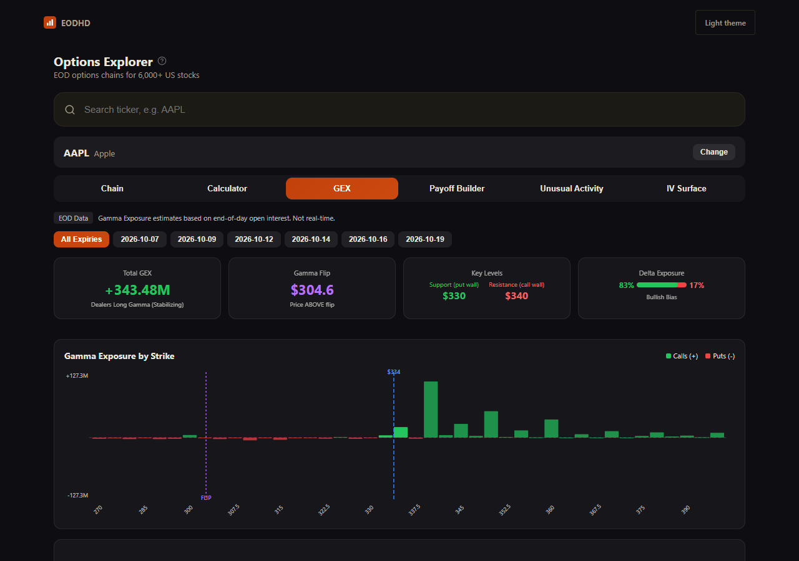

# EODHD Options Explorer

Options chain, Greeks, gamma exposure, IV surface and unusual activity — on your own EODHD key.



## Run it

```bash
git clone https://github.com/EodHistoricalData/eodhd-options-explorer
cd eodhd-options-explorer
npm ci                    # installs exactly what package-lock.json pins
cp .env.example .env      # Windows cmd: copy .env.example .env
npm start                 # http://localhost:5173
```

Put your EODHD API key in `.env` — [get one here](https://eodhd.com/register?utm_source=eodhd_oss&utm_medium=app&utm_campaign=options-explorer&utm_content=readme).
The options chain needs the Options Data Feed, a paid add-on. On a key without it the app opens and says, in EODHD's own words, that the chain is not in your plan. There is no demo mode: without a key the app tells you so
and does nothing else.

Tested in current Chrome and Firefox on Node 20 and 24. Other browsers
may work but are not tested.

Port 5173 taken (Vite uses it too)? Add `PORT=5174` to `.env` — that works
the same in every shell. A `PORT` already set in your environment wins over
`.env`; change or remove that one instead.

Your key stays in `.env` on your machine. The small server in `server/`
adds it to outgoing requests, so it never reaches the browser and never
appears in a URL. That is also why there is a server at all — `eodhd.com`
does not send CORS headers, so a page cannot call it directly.

`npm test` runs that server's tests on Node's own test runner, with nothing
more to install: the key never reaches the browser, only the feeds these apps
use are forwarded, and a `429` passes its `Retry-After` on to the page.

## Links

The address bar always describes the screen you are on, so copying it gives
somebody else the same screen, and editing it moves the open app there. The
apps keep no history of their own: Back leaves the app rather than stepping
through the screens you visited.

## What it needs from your plan

The options chain comes from the EODHD Options Data Feed, a paid add-on. Symbol search and live quotes work on any plan, including the free tier, so the app is usable while you decide.

When a request comes back `403`, the app shows you EODHD's own explanation of
what is missing rather than a generic error.

A cold load costs 0 API calls, since nothing is asked until you open a symbol; the free plan has 20 a day. Opening one costs 1 call for its quote, plus at least four pages of the options chain at 10 each (about 40–70 for a large chain such as AAPL's) against the Options add-on's own allowance rather than the daily one. A chain is kept for a quarter of an hour. The prices per request are EODHD's own:
[API limits](https://eodhd.com/financial-apis/api-limits).
## Optional: AI analysis

On first run, a one-line note above the app says it can also analyse what it
shows. Add an OpenAI-compatible key to `.env` and restart, and the analysis
buttons appear:

```bash
OPENAI_API_KEY=sk-...
# AI_BASE_URL=https://api.openai.com/v1   # or Groq, DeepSeek, OpenRouter, local Ollama
# AI_MODEL=gpt-4o-mini
```

The note goes away once the key is set, or with its × (remembered in that
browser). You are billed by your own provider. Without the key everything
else works and the AI buttons are simply not there.

## Support

These are example apps, not a product with an SLA.

- Questions about data, keys or plans → **support@eodhistoricaldata.com**
- Bugs in this code → open an issue, we get to them as time allows
- Pull requests are welcome, and land upstream in our private source
  repository — this repo is generated, so edits made here would be overwritten.
  [CONTRIBUTING.md](CONTRIBUTING.md) says which files are which

## Licence

[MIT](LICENSE.md). Use it, change it, ship it in something you sell — the only
condition is that the copyright notice travels with the code. The same goes for
the two notices that travelled here with the icons: they are Feather and
Lucide, and their licences are in [THIRD-PARTY-NOTICES.md](THIRD-PARTY-NOTICES.md).

Two things the licence does not cover. It grants no rights in any trademark:
see [TRADEMARK.md](TRADEMARK.md). And it licenses this *code*, not the *data* —
what you may do with what the API returns is governed by your own EODHD
subscription.

---

© Unicorn Data Services · Lyon, France
